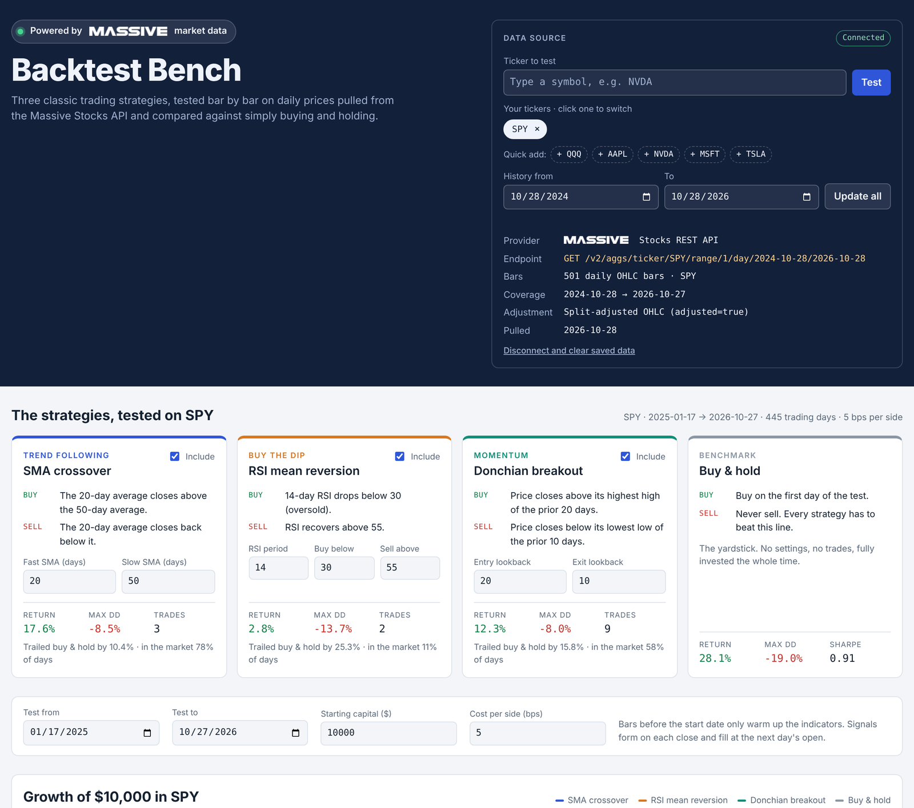

# Backtest Bench

Backtest Bench tests three classic trading strategies on real daily stock prices from the [Massive](https://massive.com) Stocks API. It compares each one against simply buying and holding. Everything runs in your web browser on your own computer, with no server and no account other than a Massive API key.



## Get started

1. **Download.** Click the green **Code** button above, then **Download ZIP**.
2. **Unzip.** On Windows, right-click the ZIP and choose **Extract All**. On a Mac, double-click it.
3. **Open the app.** Double-click **`index.html`** in the unzipped folder. It opens in your web browser on simulated demo prices.
4. **Connect Massive and pick a ticker.** In the **Data source** box at the top right, paste your Massive API key, type the **Ticker to test** (SPY is filled in), and click **Connect and test**. You don't have a key yet? [Sign up free](https://massive.com/dashboard/signup), then copy it from [your keys page](https://massive.com/dashboard/keys).
5. **Test more tickers.** Type any symbol, such as `NVDA`, in **Ticker to test** and click **Test**. Every ticker you pull stays under **Your tickers**, so you can click between them. To pull a different date range, change **History from** and **To**, then click **Update all**.

That's all. Nothing to install, and no terminal. Your key and the prices you pull stay saved in that browser, so next time just double-click `index.html` again.

Free Massive plans cover about 2 years of history and about 5 requests a minute. If you test several tickers in a row, the app waits when it hits that limit and then continues on its own.

### Prefer an AI assistant to walk you through it?

Attach the ZIP to a chat with Claude, ChatGPT or another assistant and say **"Please help me set this up by following INSTALL_WITH_AI.md."** Never paste your API key into the chat. It goes into the app's Connect box.

### For developers

The app is a single static `index.html` with no build step and no dependencies. It calls `https://api.massive.com/v2/aggs/ticker/{T}/range/1/day/{from}/{to}` straight from the browser and caches the bars in `localStorage`. To pre-load data from the command line instead, `get_data.py` (Python standard library only) writes `data/market-data.js`, which the page merges in on load:

```bash
export MASSIVE_API_KEY=your_key          # or copy .env.example to .env
python3 get_data.py --tickers SPY,QQQ,NVDA --years 2
```

## The strategies

| Strategy | Style | Buys when | Sells when |
|---|---|---|---|
| SMA crossover | Trend following | The 20-day average closes above the 50-day average | The 20-day average closes back below it |
| RSI mean reversion | Buy the dip | 14-day RSI drops below 30 | RSI recovers above 55 |
| Donchian breakout | Momentum | Price closes above its highest high of the prior 20 days | Price closes below its lowest low of the prior 10 days |
| Buy & hold | Benchmark | On the first day of the test | Never |

You can change every setting in the app, and the results update as you type. You can also load your own CSV, a Massive aggregates JSON response, or a Massive flat-file day aggregates file.

## How the test works

- **No lookahead.** A signal computed on one day's close is filled at the next day's open.
- **Costs.** Commission plus slippage, 5 basis points per side by default, is charged on every entry and exit.
- **Warm-up.** Bars before the start date only feed the indicators, so every strategy can trade from day one of the test.
- **Dividends.** Massive's adjusted bars correct for splits only, so returns exclude dividend income.
- **Metrics.** Total return, CAGR, max drawdown, Sharpe (0% risk-free rate), volatility, win rate and time in market.
- **Data checks.** The app flags gaps, duplicate dates and one-day moves over 40%, which usually mean an unadjusted split.
- **Scope.** Daily bars, long-only, one position at a time, fully invested when in a trade. No shorting, leverage or position sizing.

## Your API key and data

- The app sends your key only to Massive. If you leave **Remember on this computer** ticked, the key is also saved in your browser's local storage on that computer. Untick it to keep the key only until you close the tab.
- The prices you pull are saved in the same browser so the app opens instantly next time. **Disconnect and clear saved data** removes both the key and the prices.
- Nothing is ever uploaded anywhere else. The repo contains no keys and no Massive data, and `.gitignore` keeps `.env` and `data/market-data.js` out of git if you use the command-line script.
- If you ever share your key by accident, regenerate it at [massive.com/dashboard/keys](https://massive.com/dashboard/keys).

## Troubleshooting

| What you see | What to do |
|---|---|
| "Massive didn't accept this API key" | Copy the key again from [your keys page](https://massive.com/dashboard/keys) and paste it into Connect. |
| "Massive declined the request" | Your plan doesn't cover those dates. Free plans cover about 2 years, so move **History from** later and click **Update all**. |
| "Trying again in 20s…" | Free plans allow about 5 requests a minute. Leave the page open and it continues on its own. |
| "No usable data for XYZ" | Check the symbol. Massive uses exchange tickers such as `BRK.B`. |
| "Your browser couldn't reach Massive" | Check your internet connection. Office networks sometimes block API sites. Try another network. |
| The page asks for the key every time | Your browser may be clearing site data, or you're in a private window. Leave "Remember on this computer" ticked and use a normal window. |

## Disclaimer

Backtest Bench is an educational demo. Backtests are hypothetical, exclude taxes and dividends, and don't predict future results. Nothing here is investment advice.

## Credits

Built by Yuris Bendiks. Market data from [Massive](https://massive.com). The Massive name and logo are trademarks of Massive.com, Inc. Code released under the MIT License.
