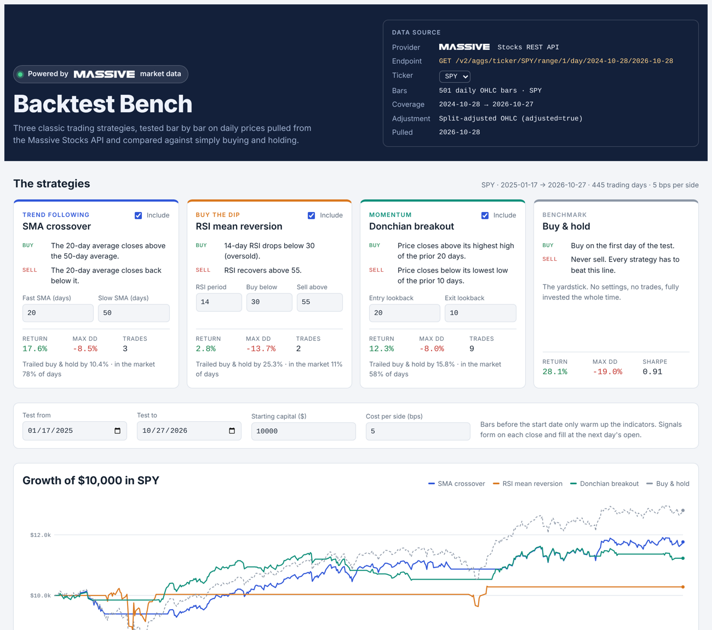

# Backtest Bench

Backtest Bench tests three classic trading strategies on real daily stock prices from the [Massive](https://massive.com) Stocks API. It compares each one against simply buying and holding. Everything runs in your web browser on your own computer, with no server and no account other than a Massive API key.



## Get started

You have three ways in. Pick the one that suits you.

### Option 1: Let an AI assistant set it up for you (easiest)

1. On this GitHub page, click the green **Code** button, then **Download ZIP**.
2. Open a chat with Claude, ChatGPT or another AI assistant and attach the ZIP file.
3. Type: **"Please install this for me by following INSTALL_WITH_AI.md."**

The assistant walks you through each step, or runs the steps itself if it can work on your computer. Never paste your API key into the chat. The setup asks for it privately on your computer.

### Option 2: Set it up yourself (about 5 minutes)

1. **Download.** Click the green **Code** button, then **Download ZIP**.
2. **Unzip.**
   - Windows: right-click the ZIP and choose **Extract All**. Double-clicking only previews the files, and the setup won't run from inside the preview.
   - Mac: double-click the ZIP.
3. **Get a free Massive API key.** Sign up at [massive.com/dashboard/signup](https://massive.com/dashboard/signup), then copy your key from [massive.com/dashboard/keys](https://massive.com/dashboard/keys).
4. **Run the setup.** Open the unzipped folder and double-click:
   - Windows: **`start-windows.bat`**. If Windows shows "Windows protected your PC", click **More info**, then **Run anyway**.
   - Mac: **`start-mac.command`**. If your Mac says it can't be opened, right-click the file, choose **Open**, then click **Open** again.
5. **Answer the questions.** Paste your key when asked; nothing appears on screen as you paste, and that's normal. Choose your tickers, or press Enter for SPY, QQQ and AAPL. Then choose how many years, or press Enter for 2.
6. Backtest Bench opens in your browser. To come back later, double-click **`index.html`** in the folder. To pull fresh prices or new tickers, run the start file again.

If the setup says Python is missing, install it from [python.org/downloads](https://www.python.org/downloads/). On Windows, tick **"Add python.exe to PATH"** on the installer's first screen. Then run the start file again.

### Option 3: Just look around

Double-click `index.html`. Without Massive data it runs on simulated prices, clearly labeled as such, so you can explore the tool before getting a key.

### For developers

```bash
git clone https://github.com/ybendiks/backtest-bench.git
cd backtest-bench
export MASSIVE_API_KEY=your_key          # or copy .env.example to .env
python3 get_data.py --tickers SPY,QQQ,NVDA --years 2
```

`get_data.py` uses only the Python standard library, so there's nothing to install. It writes `data/market-data.js`, which `index.html` loads with a plain `<script>` tag, so the app works straight from `file://`.

## The strategies

| Strategy | Style | Buys when | Sells when |
|---|---|---|---|
| SMA crossover | Trend following | The 20-day average closes above the 50-day average | The 20-day average closes back below it |
| RSI mean reversion | Buy the dip | 14-day RSI drops below 30 | RSI recovers above 55 |
| Donchian breakout | Momentum | Price closes above its highest high of the prior 20 days | Price closes below its lowest low of the prior 10 days |
| Buy & hold | Benchmark | On the first day of the test | Never |

You can change every setting in the app, and the results update as you type. You can also load your own CSV, a Massive aggregates JSON response, or a Massive flat-file day aggregates file.

## How the test works

- **No lookahead.** A signal computed on one day's close is filled at the next day's open.
- **Costs.** Commission plus slippage, 5 basis points per side by default, is charged on every entry and exit.
- **Warm-up.** Bars before the start date only feed the indicators, so every strategy can trade from day one of the test.
- **Dividends.** Massive's adjusted bars correct for splits only, so returns exclude dividend income.
- **Metrics.** Total return, CAGR, max drawdown, Sharpe (0% risk-free rate), volatility, win rate and time in market.
- **Data checks.** The app flags gaps, duplicate dates and one-day moves over 40%, which usually mean an unadjusted split.

## Your API key and data

- Your key is stored only in a `.env` file inside this folder, and only if you choose to save it. That file is listed in `.gitignore`, so it never gets uploaded to GitHub. The key is never written into `index.html` or the data file.
- Prices you pull are saved to `data/market-data.js`, which is also excluded from git. Massive's terms limit redistributing their data, so keep that file on your own machine.
- If you ever share your key by accident, regenerate it at [massive.com/dashboard/keys](https://massive.com/dashboard/keys).

## Troubleshooting

| What you see | What to do |
|---|---|
| "Python is not installed" | Install it from [python.org/downloads](https://www.python.org/downloads/). On Windows, tick "Add python.exe to PATH". |
| "Massive refused the request (401/403)" | The key is wrong, or your plan doesn't cover that much history. Try 2 years. To enter a new key, delete `.env` and run the setup again. |
| "Waiting 20 seconds…" | Free plans allow about 5 requests a minute. The script waits and continues on its own. |
| "CERTIFICATE_VERIFY_FAILED" (Mac) | Open Applications > Python 3.x and double-click "Install Certificates.command". |
| The page shows "Demo mode" | The setup hasn't saved any data yet. Run the start file again and watch for errors. |
| A ticker returns no bars | Check the symbol. Massive uses exchange tickers such as `BRK.B`. |

## Disclaimer

Backtest Bench is an educational demo. Backtests are hypothetical, exclude taxes and dividends, and don't predict future results. Nothing here is investment advice.

## Credits

Built by Yuris Bendiks. Market data from [Massive](https://massive.com). The Massive name and logo are trademarks of Massive.com, Inc. Code released under the MIT License.
